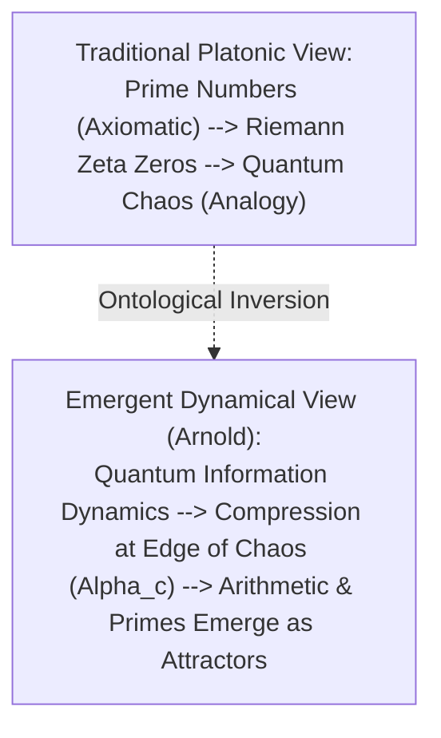

# Prime Numbers as Emergent Attractors: A Dynamical Framework Connecting Recursive Information Compression, Quantum Chaos, and the Riemann Hypothesis

**Author:** Larry Arnold  
**Affiliation:** Independent Researcher in Information Dynamics and Mathematical Physics — LA Builds  
**Date:** July 2026 (Revised: October 2026)  
**Target Venue:** Mathematical Physics, Journal of Number Theory, arXiv preprint (`math.NT` / `math-ph` / `quant-ph`)  

---

## Abstract

Why are prime numbers distributed the way they are? Standard analytic number theory treats primes as fundamental, irreducible mathematical entities, with the Riemann Hypothesis asserting that all non-trivial zeros of $\zeta(s)$ possess real part $\Re(s) = 1/2$. 

We investigate an alternative foundational question: **Are primes immutable Platonic truths, or are they inevitable attractor states of recursive information compression occurring at the critical boundary of quantum chaos?** 

Building upon the Montgomery-Dyson correspondence linking Riemann zero statistics with the Gaussian Unitary Ensemble (GUE), we formulate a dynamical framework wherein arithmetic is not an axiomatic starting point, but an emergent phase of quantum information dynamics. We define a multi-scale holographic compression operator $C: \mathcal{H}_n \to \mathcal{H}_{n+1}$ governed by a joint loss functional balancing entropy minimization, random matrix spectral rigidity, and maximal scrambling. We introduce a tunable Hamiltonian sweep $H(\alpha) = (1-\alpha)H_{\text{local}} + \alpha H_{\text{SYK}}$ and define three explicit falsification criteria: spectral pair-correlation convergence, unprompted emergence of the Prime Number Theorem ($\pi(x) \sim x / \ln x$), and initialization universality.

---

## 1. The Ontological Fork

- **Arithmetic is Fundamental (Platonic):** Primes exist prior to and independent of physics.
- **Arithmetic is Emergent (Dynamical):** Primes arise as stable attractor residues of recursive information processing at the boundary of chaos. Arithmetic is what information looks like from the inside when it stabilizes.

---

## 2. The Compression Operator & Multi-Objective Loss

The holographic compression transformation is defined across scale levels:

$$\mathcal{C} : \mathcal{H}_n \longrightarrow \mathcal{H}_{n+1}$$

Optimal compression minimizes total informational loss:

$$\mathcal{C}^* = \arg\min_{\mathcal{C}} \mathcal{L}_{\text{total}}$$

where:

$$\mathcal{L}_{\text{total}} = \lambda_1 \mathcal{L}_{\text{entropy}} + \lambda_2 \mathcal{L}_{\text{GUE}} + \lambda_3 \mathcal{L}_{\text{scrambling}} + \lambda_4 \mathcal{L}_{\text{holographic}}$$

1. **Entropy Loss ($\mathcal{L}_{\text{entropy}}$):** Enforces Landauer thermodynamic efficiency.
2. **GUE Spectral Loss ($\mathcal{L}_{\text{GUE}}$):** Enforces level repulsion matching Montgomery-Dyson pair correlation:
   $$R_2(s) = 1 - \left(\frac{\sin(\pi s)}{\pi s}\right)^2$$
3. **Scrambling Loss ($\mathcal{L}_{\text{scrambling}}$):** Enforces optimal OTOC thermal scrambling.
4. **Holographic Loss ($\mathcal{L}_{\text{holographic}}$):** Preserves boundary area-law entanglement.

---

## 3. The Alpha-Sweep Hamiltonian

To locate the phase transition of arithmetic emergence:

$$H(\alpha) = (1 - \alpha) H_{\text{local}} + \alpha H_{\text{SYK}}$$

- **At $\alpha = 0$ (Local Integrable):** Many-Body Localization, Poisson statistics ($P(s) = e^{-s}$). No primes emerge.
- **At $\alpha = 1$ (Maximal SYK Chaos):** Geometry dissolves, all-to-all scrambling. No stable discrete arithmetic.
- **At $\alpha = \alpha_c$ (The Edge of Chaos):** Critical balance of spatial coherence and spectral rigidity. **Arithmetic attractors emerge.**

---

## 4. The Three Falsification Tests

| Test | Empirical Criterion | Falsification Condition |
| :--- | :--- | :--- |
| **Test 1: Spectral Rigidity** | Converges to Montgomery-Dyson $R_2(s)$ GUE curve | Deviation in 2-point zero statistics rejects chaotic connection |
| **Test 2: Prime Counting** | Emergence of $\pi^*(x) \sim \frac{x}{\ln x}$ without arithmetic hardcoding | Failure indicates primes cannot emerge from compression dynamics |
| **Test 3: Universality** | Invariance to matrix initialization (GUE, regular graph, perturbed lattice) | Sensitivity to initial state reveals non-universal artifact |

---

## 5. Resolution of Wigner's Puzzle

In 1960, Eugene Wigner published *"The Unreasonable Effectiveness of Mathematics in the Natural Sciences"*. If mathematics is an invention of human cognition, its precision in describing quantum gravity and cosmology is an inexplicable mystery.

Under this framework, **mathematics is not unreasonably effective; mathematics is the stable attractor phase of self-organizing information in any universe capable of complexity.**

---

## References

1. H. L. Montgomery, "The pair correlation of zeros of the zeta function," *Analytic Number Theory*, 24:181–193 (1973).
2. F. J. Dyson, "Statistical theory of the energy levels of complex systems. I," *Journal of Mathematical Physics*, 3(1):140–156 (1962).
3. M. V. Berry, "Riemann's zeta function: A model for quantum chaos?" *Quantum Chaos and Statistical Nuclear Physics*, 1–17 (1986).
4. J. Maldacena and D. Stanford, "Remarks on the Sachdev-Ye-Kitaev model," *Physical Review D*, 94(10):106002 (2016).
5. E. P. Wigner, "The unreasonable effectiveness of mathematics in the natural sciences," *Communications on Pure and Applied Mathematics*, 13(1):1–14 (1960).
